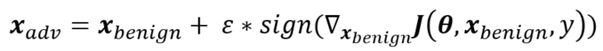

# FGSM 对抗攻击：MNIST 上的最小实现与复现

本仓库包含两部分工作：

| 部分 | 入口 | 说明 |
|------|------|------|
| 从零实现 | [`fgsm_mnist.py`](fgsm_mnist.py) | 单文件 FGSM 最小版本，用于验证对攻击原理的理解 |
| 复现 | [`README_legacy.md`](README_legacy.md) | 复现 [1Konny/FGSM](https://github.com/1Konny/FGSM)，含 PyTorch 兼容性修复与 epsilon 扫描 |

## 原理



FGSM 沿损失对输入的梯度符号方向做一步扰动：

```
x_adv = x + ε · sign(∇_x J(θ, x, y))
```

无目标攻击时最大化真实标签上的损失；有目标攻击时最小化目标类上的损失。ε 控制扰动幅度。

## 环境

- Python 3.x + PyTorch (CPU)
- `pip install torch torchvision pillow matplotlib`

> 如果导入 torch 时报 `OMP: Error #15`（libiomp5md.dll 被重复加载），在运行前设置
> `KMP_DUPLICATE_LIB_OK=TRUE` 即可继续。这是 Intel OpenMP 运行时的已知冲突。

## 最小实现：fgsm_mnist.py

单文件完成训练、FGSM 生成与评估，共 72 行（57 行非空）。

- 模型：`SimpleNet`，784 → 128 → 10 的全连接网络（ReLU）
- 数据：MNIST，`ToTensor()` 后像素范围 [0, 1]，**不做归一化**
- 训练：Adam，lr=1e-3，batch=64，全量训练集 1 个 epoch
- 攻击：单步 FGSM，ε=0.15，逐张攻击测试集全部 10 000 张
- 随机性：`torch.manual_seed(1)`，结果可复现

```bash
python fgsm_mnist.py
```

### 结果

| Epsilon | Clean Acc | Adversarial Acc |
|---------|-----------|-----------------|
| 0.15 | 94.3% | 1.9% |

固定 `seed=1` 后的实测值。此前一次未固定种子的运行得到 1.5%，差异来自权重初始化与数据打乱顺序的不同。

## 数据说明

- MNIST：60 000 张训练图 / 10 000 张测试图，28×28 灰度，10 类（0–9）。
- 两个脚本共用 `datasets/MNIST/`，首次运行自动下载，该目录已加入 `.gitignore`。
- 两者的预处理不同，**ε 不能直接横向比较**：
  - `fgsm_mnist.py`：`ToTensor()` → 像素范围 [0, 1]
  - legacy 复现：`ToTensor()` + `Normalize((0.5,), (0.5,))` → 范围 [-1, 1]
- 换算关系：[-1, 1] 上的一步 ε 等于 [0, 1] 像素空间上的 ε/2。因此 legacy 的 ε=0.2 相当于像素空间 0.1，
  而 `fgsm_mnist.py` 的 ε=0.15 相当于归一化空间 0.30，扰动强度约为 legacy 的 1.5 倍。

## 与 1Konny 实现的对比

| 实现 | 分类器 | 输入范围 | ε（像素空间） | Clean Acc | Adversarial Acc |
|------|--------|----------|---------------|-----------|-----------------|
| 1Konny（legacy） | MLP 784→300→150→10 | [-1, 1] | 0.10（原参数 0.2） | 96% | 31% |
| 本仓库最小实现 | MLP 784→128→10 | [0, 1] | 0.15 | 94.3% | 1.9% |

有两点需要说明：

1. **两个模型都是全连接网络，不是 CNN。** [`models/toynet.py`](models/toynet.py) 是 784→300→150→10 的 MLP，
   `SimpleNet` 是 784→128→10。所以这组对比不能用来论证卷积的归纳偏置。
2. 差异的可解释来源：`fgsm_mnist.py` 的像素级扰动约为 legacy 的 1.5 倍；SimpleNet 容量更小
   （约 10 万参数，ToyNet 约 28 万）；两者学习率（1e-3 vs 2e-4）与 batch size 也不同。
   干净准确率仅差 1.7 个百分点，对抗准确率却相差 29 个百分点，说明小容量 MLP 在这组设置下更脆弱。

若要验证“归纳偏置对鲁棒性的影响”，需要补一个与 SimpleNet 同容量、同训练设置的 CNN 对照实验。

## 复现部分（legacy）

完整的复现说明见 [`README_legacy.md`](README_legacy.md)，包括：

- PyTorch 0.4+ 兼容性修复（`.data[0]` → `.item()`）
- Windows 文件名非法字符 `:` → `_`
- 无目标 / 有目标 FGSM 的 epsilon 扫描结果


该图由 [`make_comparison_grid.py`](make_comparison_grid.py) 生成，每行对应一个 epsilon：
左列为干净样本，中间列为 FGSM 对抗样本，右列标记预测是否翻转（绿框未变、红框改变）。

## 目录说明

- `fgsm_mnist.py`：最小实现
- `README_legacy.md`：1Konny/FGSM 复现说明
- `main.py` / `solver.py` / `adversary.py` / `models/` / `utils/` / `datasets/datasets.py`：原仓库代码
- `make_comparison_grid.py` / `comparison_grid.png`：复现实验的对比图
- `datasets/`：自动下载的 MNIST 数据，不纳入版本控制
- `checkpoints/`、`output/`：权重与生成图片，不纳入版本控制（保留空目录）
- `misc/`：原仓库示意图

## 参考

1. Goodfellow et al., *Explaining and Harnessing Adversarial Examples*, [arXiv:1412.6572](https://arxiv.org/abs/1412.6572)
2. Kurakin et al., *Adversarial Examples in the Physical World*, [arXiv:1607.02533](https://arxiv.org/abs/1607.02533)
3. [1Konny/FGSM](https://github.com/1Konny/FGSM)（WonKwang Lee）
