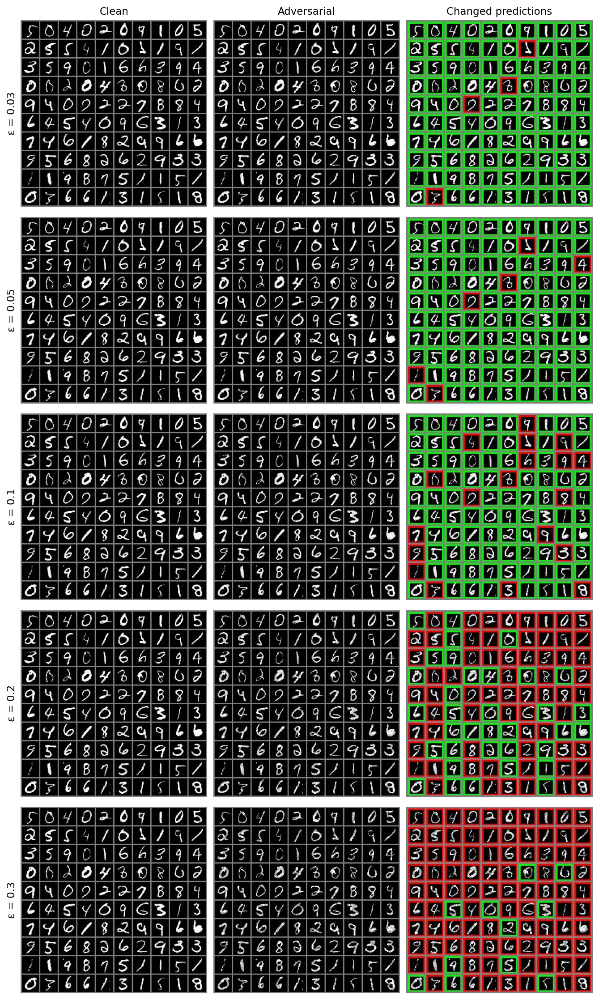

# FGSM Adversarial Attack on MNIST（legacy 复现部分）

> 本文件是 1Konny/FGSM 复现部分的说明。项目主 README 见 [README.md](README.md)。

复现 [1Konny/FGSM](https://github.com/1Konny/FGSM)，修复 PyTorch 0.4+ 兼容性问题，在 MNIST 上完成 FGSM 对抗攻击的定量评估（epsilon 扫描 + 有目标攻击）。

> 原始实现由 WonKwang Lee 提供。本仓库的修改包括：PyTorch 0.4+ API 兼容性修复、Windows 文件名处理、epsilon 扫描实验与结果可视化。

## 环境
- Python 3.x + PyTorch (CPU)
- `pip install torch torchvision pillow matplotlib`

## 运行
```bash
# 训练（1 个 epoch 即可复现 96% 干净准确率）
python main.py --mode train --dataset MNIST --env_name cputorch --cuda False --epoch 1

# 无目标 FGSM 攻击（epsilon 可调）
python main.py --mode generate --dataset MNIST --iteration 1 --epsilon 0.1 --env_name cputorch --cuda False --load_ckpt best_acc.tar

# 有目标 FGSM 攻击（指定目标类别为 3）
python main.py --mode generate --dataset MNIST --iteration 1 --epsilon 0.2 --target 3 --env_name cputorch --cuda False --load_ckpt best_acc.tar
```

## 修复的兼容性问题
- `.data[0]` → `.item()`（PyTorch 0.4+ 不再支持 0 维 tensor 索引）
- Windows 文件名非法字符 `:` → `_`

## 数据集说明
`main.py` 的 `--dataset` 默认值是 `FMNIST`，但 `datasets/datasets.py` 用 `if 'MNIST' in name` 做判断，`"FMNIST"` 会命中该子串，实际加载的仍是 MNIST。本仓库的命令显式传入 `--dataset MNIST` 以消除歧义；若要真正使用 Fashion-MNIST，需要把 `torchvision.datasets.MNIST` 换成 `FashionMNIST` 并修正这段判断逻辑。

## 实验结果

### 无目标攻击（Untargeted FGSM，100 张测试图）

| Epsilon | Clean Acc | Adversarial Acc |
|---------|-----------|-----------------|
| 0.03 | 96% | 92% |
| 0.05 | 96% | 90% |
| 0.10 | 96% | 77% |
| 0.20 | 96% | 31% |
| 0.30 | 96% | 7% |

### 有目标攻击（Targeted FGSM, target=3，100 张测试图）

| Epsilon | Clean Acc | Accuracy on True Label |
|---------|-----------|------------------------|
| 0.03 | 96% | 96% |
| 0.10 | 96% | 89% |
| 0.20 | 96% | 52% |
| 0.30 | 96% | 23% |

## 可视化对比



由 `make_comparison_grid.py` 生成，每行对应一个 epsilon。左列为干净样本；中间列为 FGSM 生成的对抗样本；右列标记预测是否翻转——绿框表示预测未变，红框表示预测被改变。对抗样本与干净样本肉眼几乎不可区分，但误判数量随 epsilon 增大显著上升。

## 目录说明
- `datasets/`：首次运行自动下载 MNIST 原始数据，数据目录不纳入版本控制，`datasets/datasets.py` 源码仍会提交
- `checkpoints/`：模型权重，不纳入版本控制（保留空目录）
- `output/`：生成的对抗样本图片，不纳入版本控制（保留空目录）
